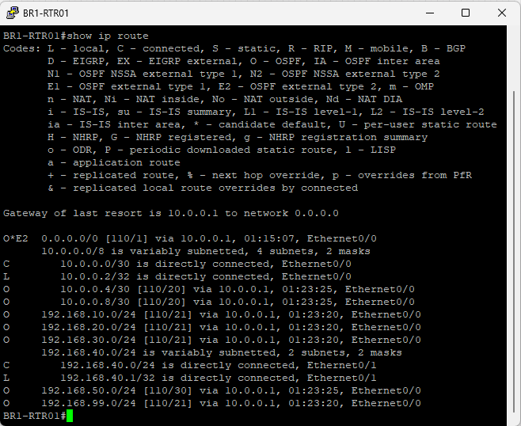
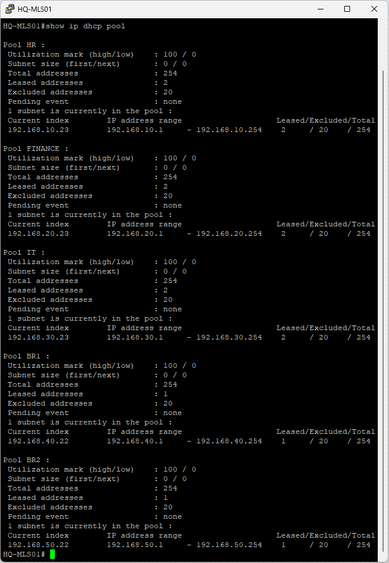
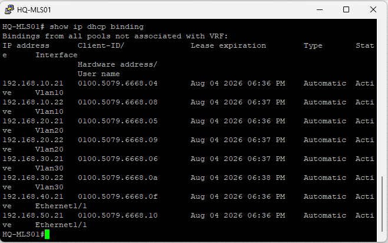
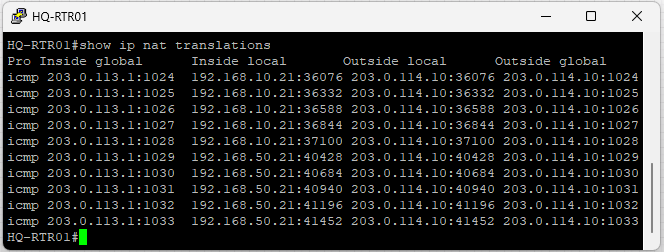
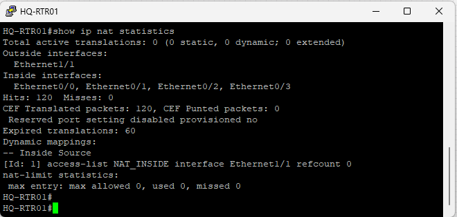

## Overview

This section verifies that the enterprise network services introduced in Project 06 have been successfully implemented while preserving the routing infrastructure established in previous projects.

The verification process confirms successful DHCP operation, DHCP Relay functionality, NAT/PAT translation, Internet connectivity, ACL policy enforcement, OSPF default route propagation, and end-to-end communication across the enterprise network.

---

## 1. EVE-NG Lab Deployment Verification

### Objective

Verify that the complete enterprise network services topology has been successfully deployed in the EVE-NG lab environment.

### Expected Result

The deployed topology includes:

- Headquarters campus
- Branch 1
- Branch 2
- ISP router
- Enterprise WAN
- Centralized DHCP server
- NAT/PAT
- Enterprise ACL security policies

### Evidence


---

## 2. OSPF Default Route Verification

### Objective

Verify that the default route is successfully propagated throughout the enterprise using OSPF.

### Verification Command

```cisco
show ip route
```

### Expected Result

The routing table contains an OSPF-learned default route (O*E2), allowing all enterprise sites to reach external destinations through the headquarters edge router.

### Evidence



---

## 3. DHCP Pool Verification

### Objective

Verify that the centralized DHCP server has successfully created all required DHCP address pools.

### Verification Command

```cisco
show ip dhcp pool
```

### Expected Result

The DHCP server contains address pools for:

- HR
- FINANCE
- IT
- BRANCH1
- BRANCH2

### Evidence



---

## 4. DHCP Binding Verification

### Objective

Verify that enterprise client devices have successfully obtained IPv4 addresses from the centralized DHCP server.

### Verification Command

```cisco
show ip dhcp binding
```

### Expected Result

Dynamic DHCP bindings are displayed for enterprise client devices from multiple network segments.

### Evidence



---

## 5. NAT Translation Verification

### Objective

Verify that private IPv4 addresses are successfully translated to the public interface using Port Address Translation (PAT).

### Verification Command

```cisco
show ip nat translations
```

### Expected Result

Active NAT translations are displayed, mapping internal private addresses to the public interface address of HQ-RTR01.

### Evidence



---

## 6. NAT Statistics Verification

### Objective

Verify that NAT/PAT is actively processing enterprise traffic.

### Verification Command

```cisco
show ip nat statistics
```

### Expected Result

NAT statistics display active translation activity, packet hits, and inside/outside interface assignments.

### Evidence



---

## 7. Headquarters Access Verification

### Objective

Verify that branch users maintain full connectivity to authorized Headquarters VLANs.

### Verification

```text
ping 192.168.10.21
ping 192.168.20.21
ping 192.168.30.21
```

### Expected Result

Branch users successfully communicate with the HR, Finance, and IT VLANs located at Headquarters.

### Evidence


---

## 8. ACL Security Policy Verification

### Objective

Verify that the enterprise ACL security policy is correctly enforced.

### Verification

```text
ping 192.168.99.10
ping 192.168.50.21
ping 203.0.113.2
```

### Expected Result

The configured ACL successfully:

- Denies access to the Management VLAN.
- Denies communication between Branch 1 and Branch 2.
- Denies ICMP Echo Requests to the ISP router interface.

### Evidence


---

## 9. Internet Connectivity Verification

### Objective

Verify that enterprise users can successfully access the simulated Internet resource while ACL policies remain enforced.

### Verification

```text
ping 203.0.114.10
```

### Expected Result

Enterprise users successfully reach the simulated Internet resource through HQ-RTR01 using NAT/PAT.

### Evidence


---

## 10. ACL Hit Counter Verification

### Objective

Verify that the configured ACLs are actively processing enterprise traffic.

### Verification Command

```cisco
show access-lists
```

### Expected Result

ACL hit counters increase after successful traffic verification, confirming that the configured security policies are actively filtering network traffic.

### Evidence


---

## 11. DHCP Relay Verification

### Objective

Verify that the branch routers correctly forward DHCP broadcast requests to the centralized DHCP server.

### Verification Command

```cisco
show running-config interface Ethernet0/1
```

### Expected Result

The branch LAN interface contains the configured DHCP Relay (`ip helper-address`), forwarding DHCP requests to the centralized DHCP server located at Headquarters.

### Evidence


---

## Verification Summary

The verification process confirms that centralized DHCP services, DHCP Relay, NAT/PAT, OSPF default route propagation, Internet connectivity, and enterprise ACL security policies have been successfully implemented.

All enterprise services operate as designed while preserving the routing infrastructure established in previous projects.