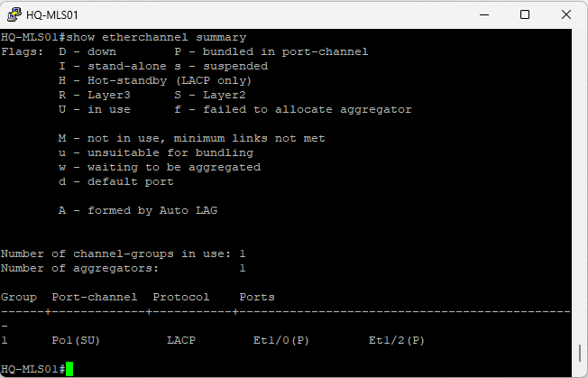
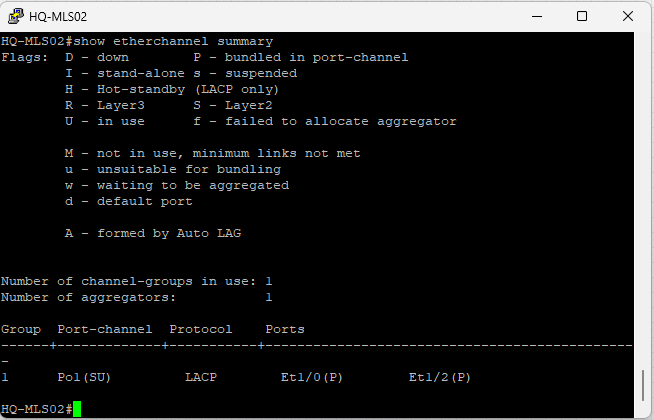
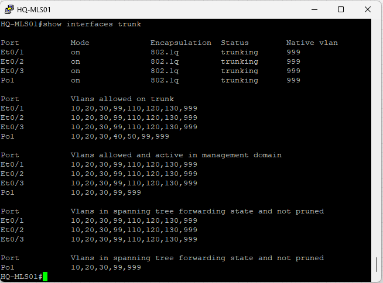
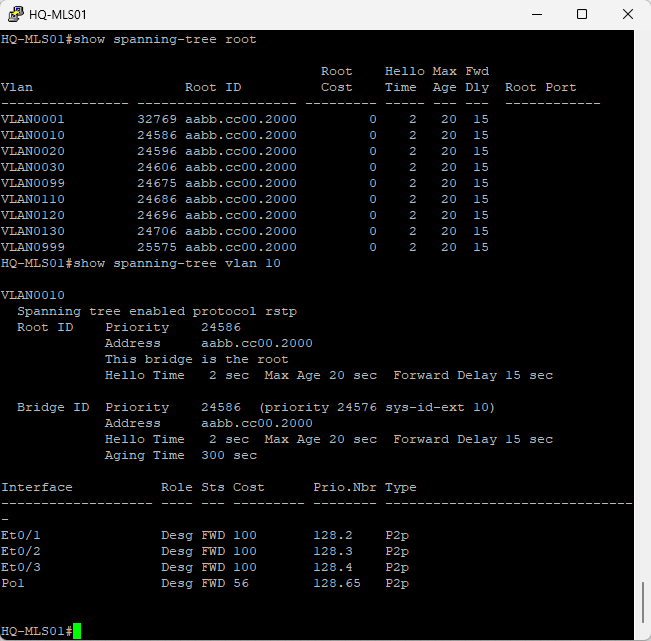
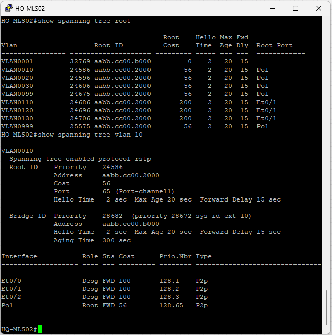
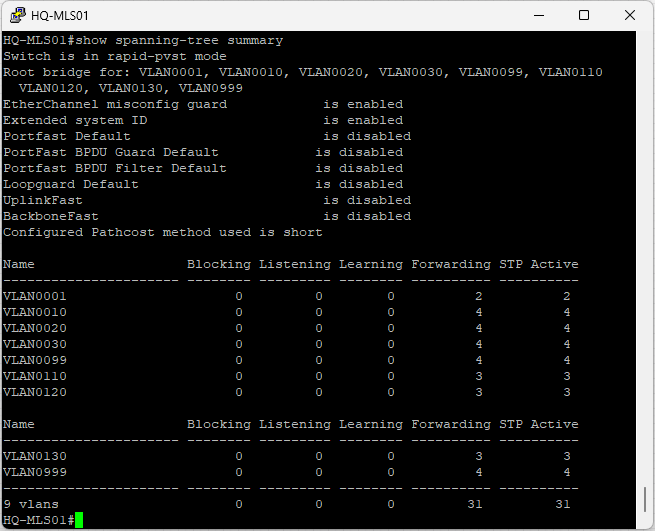
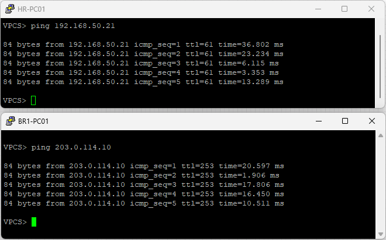

## Overview

The implementation was verified to confirm the successful operation of EtherChannel, Rapid PVST+, and Layer 2 redundancy while preserving all enterprise services implemented in previous projects.

The verification process confirmed that the Port-Channel was successfully established, Rapid PVST+ selected the expected Root Bridge, and all existing enterprise services continued to operate normally after introducing Layer 2 redundancy.

---

## Verification 1 – Enterprise Topology

The final enterprise topology was verified in EVE-NG after implementing EtherChannel and Rapid PVST+.

**Result**

- EtherChannel successfully deployed between HQ-MLS01 and HQ-MLS02.
- The existing enterprise topology was preserved, with additional physical links between HQ-MLS01 and HQ-MLS02 to support the EtherChannel.


---

## Verification 2 – EtherChannel Formation (HQ-MLS01)

The EtherChannel status was verified on HQ-MLS01.

**Command**

```text
show etherchannel summary
```

**Result**

- Port-Channel1 is operational.
- LACP successfully formed the EtherChannel.
- Both physical interfaces are bundled into Port-Channel1.



---

## Verification 3 – EtherChannel Formation (HQ-MLS02)

The EtherChannel status was verified on HQ-MLS02.

**Command**

```text
show etherchannel summary
```

**Result**

- Port-Channel1 is operational.
- LACP successfully established the logical link.
- Both member interfaces are active.



---

## Verification 4 – Port-Channel Trunk Operation

The Port-Channel trunk configuration was verified.

**Command**

```text
show interfaces trunk
```

**Result**

- Port-Channel1 is operating as an IEEE 802.1Q trunk.
- Native VLAN is 999.
- All required VLANs are successfully carried across the EtherChannel.



---

## Verification 5 – Root Bridge Election

Rapid PVST+ Root Bridge election was verified on HQ-MLS01.

**Commands**

```text
show spanning-tree root
show spanning-tree vlan 10
```

**Result**

- HQ-MLS01 is the Root Bridge.
- Port roles are operating as expected.
- All forwarding paths are functioning normally.



---

## Verification 6 – Secondary Root Verification

Rapid PVST+ operation was verified on HQ-MLS02.

**Commands**

```text
show spanning-tree root
show spanning-tree vlan 10
```

**Result**

- HQ-MLS02 recognizes HQ-MLS01 as the Root Bridge.
- Port-Channel1 operates as the Root Port.
- Layer 2 forwarding is functioning correctly.



---

## Verification 7 – Rapid PVST+ Summary

The overall spanning-tree status was verified.

**Command**

```text
show spanning-tree summary
```

**Result**

- Rapid PVST+ is enabled.
- Spanning-tree is operating normally.
- No abnormal Layer 2 conditions were observed.



---

## Verification 8 – End-to-End Connectivity

End-to-end connectivity was verified after implementing Layer 2 redundancy.

**Verification**

- Headquarters to Branch connectivity
- Branch to Headquarters connectivity
- Enterprise Internet connectivity

**Result**

All previously implemented services remained fully operational after introducing EtherChannel and Rapid PVST+.



---

## Verification Summary

The verification process confirms that Project 07 was successfully implemented.

EtherChannel provides redundant Layer 2 connectivity between HQ-MLS01 and HQ-MLS02, while Rapid PVST+ ensures a stable, loop-free switching topology. All enterprise services implemented in Projects 01 through 06 continue to operate without interruption.