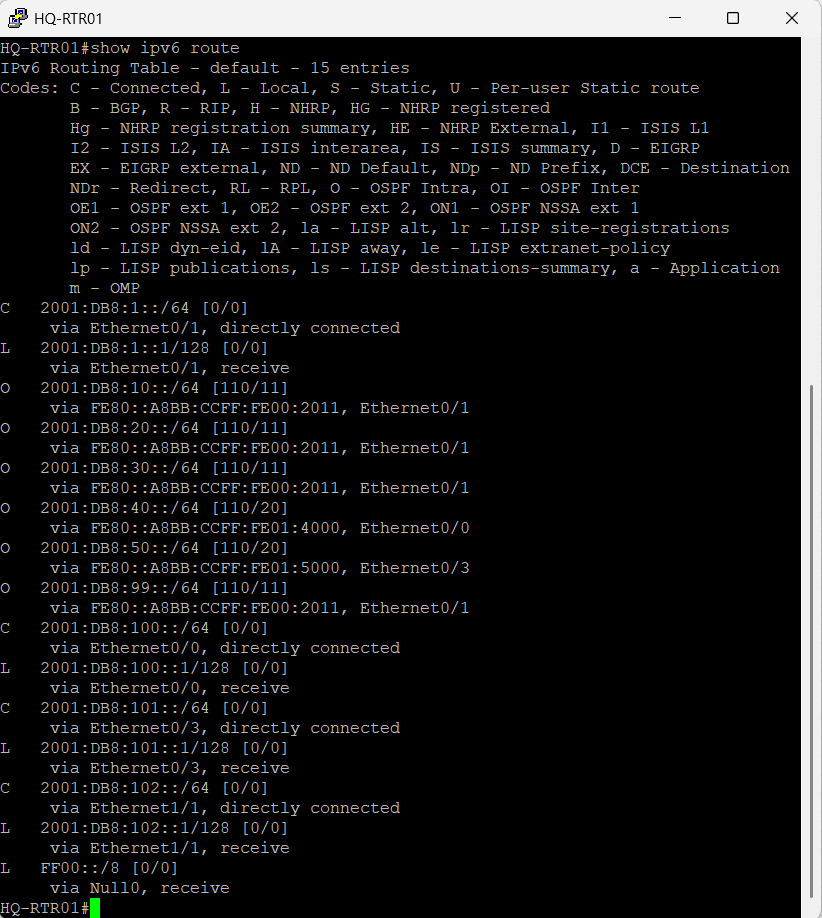
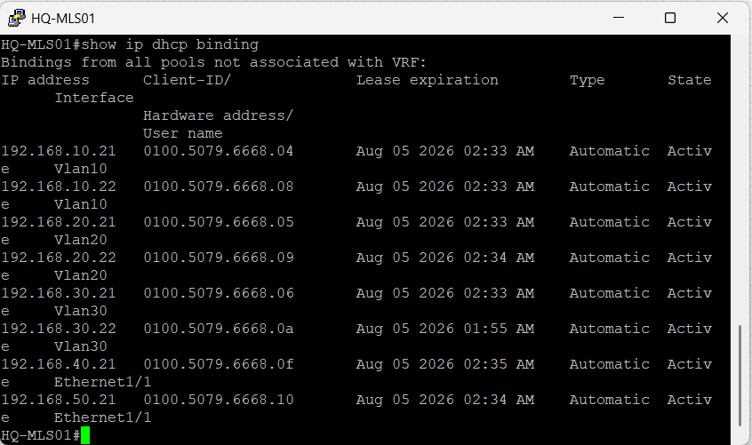
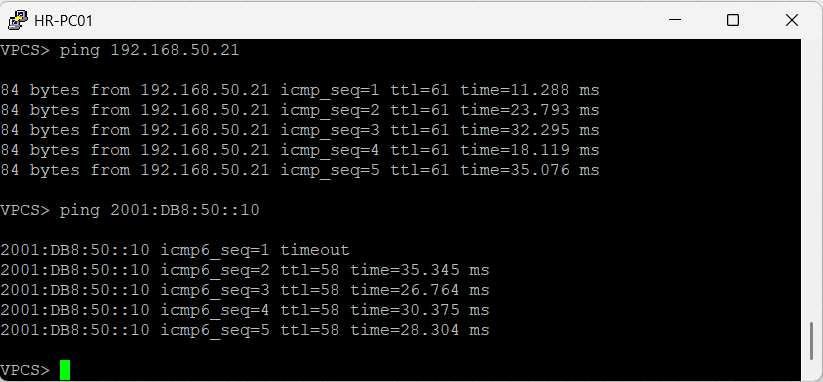
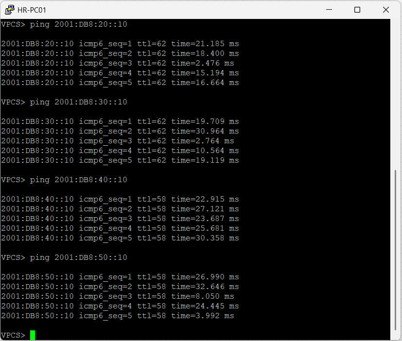
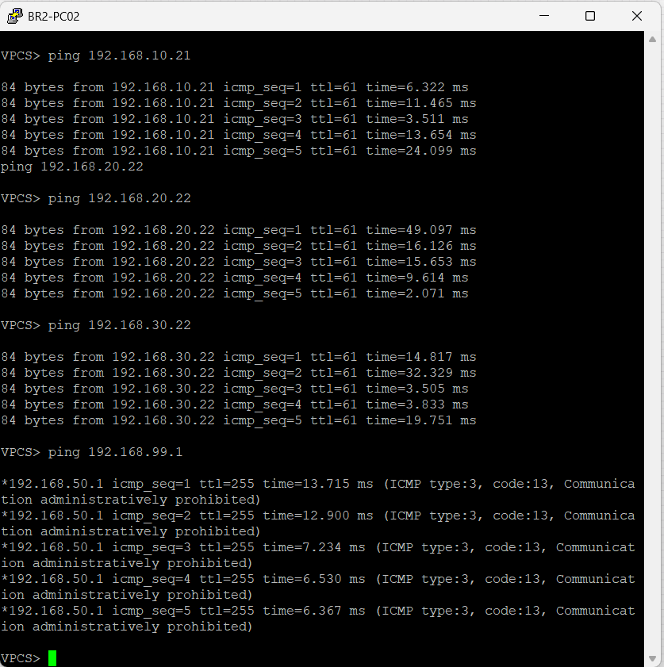

## Overview

The implementation was verified to confirm the successful deployment of IPv6, Dual Stack operation, OSPFv3 dynamic routing, and end-to-end enterprise connectivity while preserving all IPv4 services implemented in previous projects.

The verification process confirmed that IPv4 and IPv6 operate simultaneously across the enterprise network, OSPFv3 successfully exchanges IPv6 routes, DHCP services remain fully operational, and all enterprise services continue to function correctly after introducing IPv6.

---

## Verification 1 – Enterprise Topology

The final enterprise topology was verified in EVE-NG after implementing IPv6 across the enterprise network.

**Result**

- IPv6 was successfully deployed across all enterprise locations.
- The existing physical topology remained unchanged.
- Dual Stack operation was successfully introduced.


---

## Verification 2 – IPv6 Interface Verification

The IPv6 interface configuration was verified on HQ-MLS01.

**Command**

```text
show ipv6 interface brief
```

**Result**

- IPv6 addresses were successfully assigned.
- All VLAN interfaces are operational.
- All interfaces are in the Up state.


---

## Verification 3 – OSPFv3 Neighbor Adjacency

OSPFv3 neighbor relationships were verified on HQ-RTR01.

**Command**

```text
show ipv6 ospf neighbor
```

**Result**

- All OSPFv3 neighbors reached the FULL state.
- IPv6 routing adjacencies were successfully established.


---

## Verification 4 – IPv6 Routing Table

The IPv6 routing table was verified.

**Command**

```text
show ipv6 route
```

**Result**

- All enterprise IPv6 networks were successfully learned through OSPFv3.
- Dynamic IPv6 routing is operating correctly.



---

## Verification 5 – DHCP Verification

DHCP operation was verified after introducing IPv6.

**Commands**

```text
show ip dhcp binding
```

**Result**

- Clients successfully received IPv4 addresses.
- Centralized DHCP services continued to operate normally.
- IPv4 services remained unaffected by the IPv6 deployment.



---

## Verification 6 – Dual Stack Operation

Dual Stack functionality was verified using IPv4 and IPv6 connectivity tests.

**Verification**

- IPv4 connectivity
- IPv6 connectivity

**Result**

- IPv4 communication remained fully operational.
- IPv6 communication was successfully established.
- Both protocol stacks operated simultaneously.



---

## Verification 7 – IPv6 End-to-End Connectivity

End-to-end IPv6 communication was verified between Headquarters and both branch offices.

**Verification**

- Headquarters to Branch 1
- Headquarters to Branch 2
- Inter-VLAN IPv6 communication


**Result**

IPv6 connectivity was successfully established throughout the enterprise network.



---

## Verification 8 – ACL Verification

The enterprise security policies were verified after enabling IPv6.

**Verification**

- Access to Headquarters user VLANs
- Restricted access to the Management VLAN
- Internet connectivity

**Result**

- ACL policies continued to operate correctly.
- Security restrictions remained unchanged after introducing IPv6.



---

## Verification Summary

The verification process confirms that Project 08 was successfully implemented.

IPv6 was successfully integrated into the NorthStar Enterprise Network using a Dual Stack architecture while preserving all previously implemented IPv4 services. OSPFv3 dynamically exchanges IPv6 routes across the enterprise, DHCP services continue to operate correctly, Layer 2 redundancy remains fully operational, and both IPv4 and IPv6 provide reliable end-to-end connectivity throughout the enterprise network.