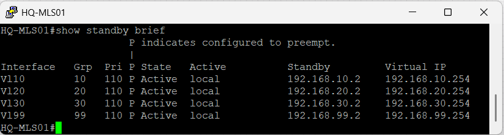
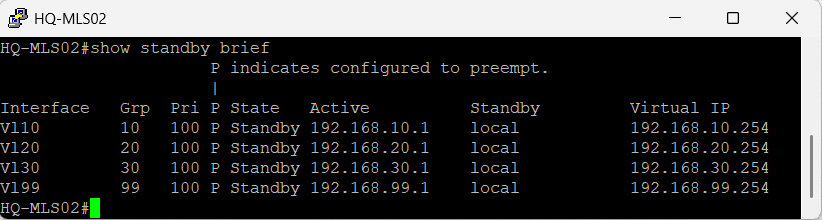
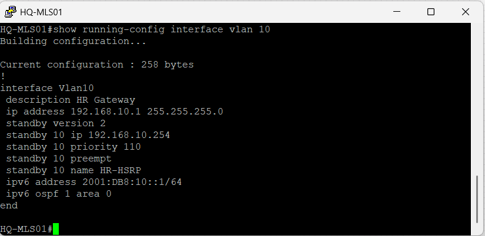
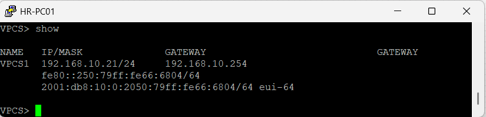
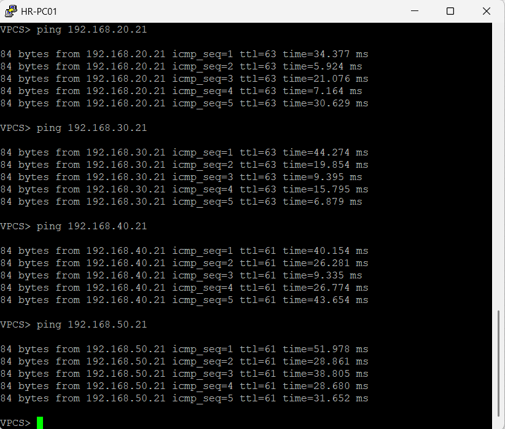
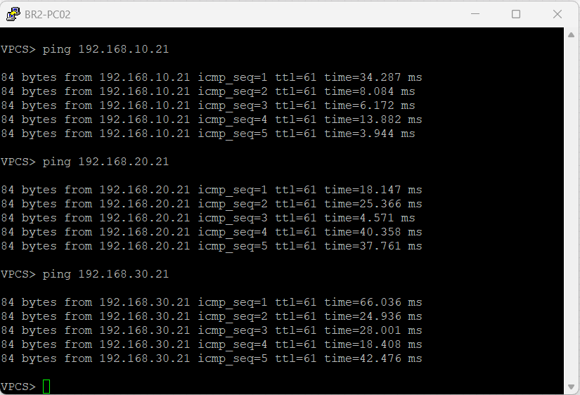

## Overview

The implementation was verified to confirm the successful deployment of First Hop Redundancy Protocol (HSRP) across the Headquarters VLANs while preserving the enterprise connectivity established in previous projects.

The verification process confirmed the expected HSRP Active and Standby roles, correct virtual gateway addressing, DHCP distribution of the HSRP virtual gateway, end-to-end enterprise connectivity, and HSRP failover and recovery for VLAN 10.

---

## Verification 1 – Enterprise Topology

The enterprise topology was verified in EVE-NG after implementing HSRP on the Headquarters multilayer switches.

**Result**

- HSRP was deployed using the existing Headquarters multilayer switches.
- No additional network devices were introduced.
- The existing enterprise topology remained operational after the HSRP implementation.


---

## Verification 2 – HQ-MLS01 HSRP Status

HSRP status was verified on HQ-MLS01.

**Command**

```text
show standby brief
```

**Result**

- HQ-MLS01 operates as the Active gateway for VLANs 10, 20, 30, and 99.
- HQ-MLS01 uses HSRP priority 110.
- Preemption is enabled.
- HQ-MLS02 is recognized as the Standby gateway.
- The HSRP virtual gateway addresses are correctly configured.



---

## Verification 3 – HQ-MLS02 HSRP Status

HSRP status was verified on HQ-MLS02.

**Command**

```text
show standby brief
```

**Result**

- HQ-MLS02 operates as the Standby gateway for VLANs 10, 20, 30, and 99.
- HQ-MLS02 uses HSRP priority 100.
- Preemption is enabled.
- HQ-MLS01 is recognized as the Active gateway.
- The same HSRP virtual gateway addresses are present on both multilayer switches.



---

## Verification 4 – HSRP Configuration

The HSRP configuration was verified on the VLAN 10 interface of HQ-MLS01.

**Command**

```text
show running-config interface vlan 10
```

**Result**

- HSRP Version 2 is configured.
- HSRP group 10 is configured.
- The virtual gateway is 192.168.10.254.
- HQ-MLS01 uses priority 110.
- Preemption is enabled.
- The HSRP group name is configured as HR-HSRP.



---

## Verification 5 – DHCP HSRP Gateway Verification

Client addressing was verified after updating the DHCP default gateway configuration.

**Command**

```text
show
```

**Result**

- HR-PC01 received IPv4 address 192.168.10.21/24.
- The client received 192.168.10.254 as its default gateway.
- The configured gateway matches the HSRP virtual IP address for VLAN 10.



---

## Verification 6 – Headquarters End-to-End Connectivity

Connectivity from HR-PC01 to other enterprise networks was verified after implementing HSRP.

**Verification**

HR-PC01 successfully reached:

- Finance network host 192.168.20.21
- IT network host 192.168.30.21
- Branch 1 host 192.168.40.21
- Branch 2 host 192.168.50.21

**Result**

Inter-VLAN and Headquarters-to-branch connectivity remained operational after the HSRP implementation.



---

## Verification 7 – Branch-to-Headquarters Connectivity

Connectivity from BR2-PC02 to the Headquarters networks was verified.

**Verification**

BR2-PC02 successfully reached:

- HR network host 192.168.10.21
- Finance network host 192.168.20.21
- IT network host 192.168.30.21

**Result**

Branch-to-Headquarters connectivity remained operational after the HSRP implementation.



---

## Verification 8 – HSRP VLAN 10 Failover

HSRP failover was verified for VLAN 10.

**Command**

```text
show standby brief
```

**Result**

- HQ-MLS02 assumed the Active role for HSRP group 10.
- The VLAN 10 virtual gateway remained 192.168.10.254.
- VLANs 20, 30, and 99 remained in the Standby state on HQ-MLS02.
- The verification confirmed the HSRP role transition for VLAN 10.


---

## Verification 9 – HSRP VLAN 10 Failback

HSRP recovery was verified after restoring the preferred Active gateway.

**Command**

```text
show standby brief
```

**Result**

- HQ-MLS01 resumed the Active role for VLAN 10.
- HQ-MLS02 returned to the Standby role.
- The VLAN 10 virtual gateway remained 192.168.10.254.
- The result confirms the expected HSRP failback behavior with preemption enabled.


---

## Verification Summary

The verification process confirms the successful implementation of HSRP within the Headquarters network.

HQ-MLS01 operates as the preferred Active gateway and HQ-MLS02 as the Standby gateway for VLANs 10, 20, 30, and 99. DHCP successfully provides the HSRP virtual gateway to the verified client, and end-to-end connectivity between Headquarters and branch networks remains operational.

HSRP failover and failback were successfully verified for VLAN 10, demonstrating that HQ-MLS02 can assume the Active role and that HQ-MLS01 can resume its preferred Active role through preemption after recovery.