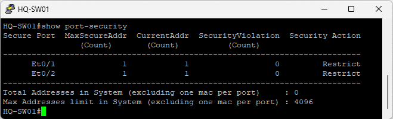
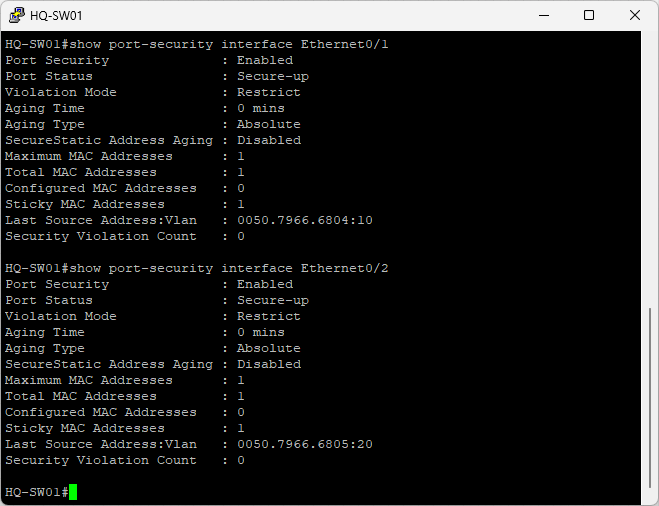
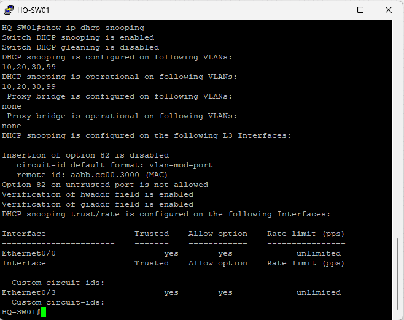
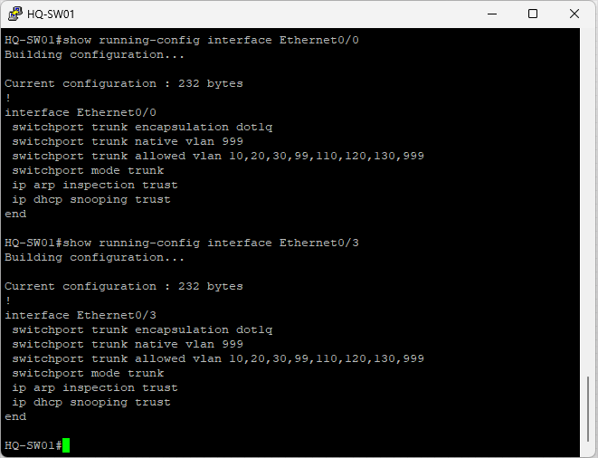
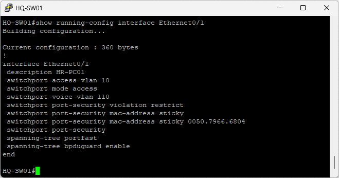
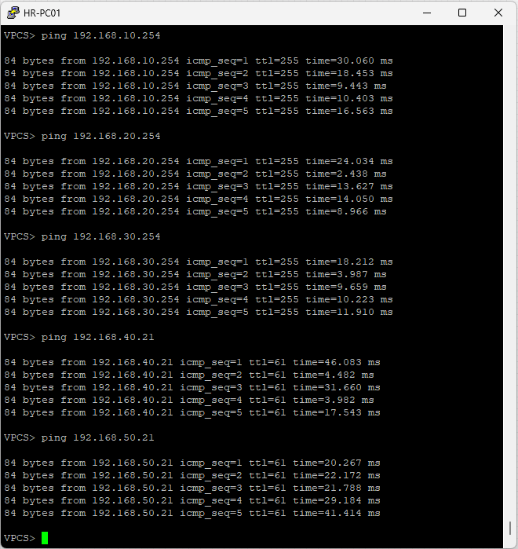

## Overview

Project 10 verification focused on validating the Layer 2 security features implemented across the enterprise access layer and confirming IPv4 enterprise connectivity after the security policies were applied.

Port Security, Sticky MAC Address Learning, DHCP Snooping, PortFast, and BPDU Guard were implemented as the final Layer 2 security controls.

Dynamic ARP Inspection (DAI) and Storm Control were also evaluated during implementation. However, limitations encountered with the Cisco IOL images used in the EVE-NG environment prevented these features from being included in the final deployment.

---

## Verification 1 – Enterprise Topology

The enterprise topology was reviewed in EVE-NG after implementing the supported Layer 2 security features.

**Result**

- The physical enterprise topology remained unchanged.
- No additional network devices or physical connections were introduced as part of Project 10.


---

## Verification 2 – Port Security Status

Port Security status was verified on HQ-SW01.

**Command**

```text
show port-security
```

**Result**

- Ethernet0/1 and Ethernet0/2 are operating as secured interfaces.
- Each interface has a maximum of one secure MAC address.
- Each interface has one currently learned secure MAC address.
- Restrict mode is active.
- No security violations are recorded in the captured verification state.



---

## Verification 3 – Port Security Interface

Detailed Port Security operation was verified on the secured user-facing interfaces of HQ-SW01.

**Command**

```text
show port-security interface Ethernet0/1
show port-security interface Ethernet0/2
```

**Result**

- Port Security is enabled.
- The interfaces are in Secure-up state.
- Sticky MAC Address learning is active.
- The maximum number of secure MAC addresses is one.
- Restrict mode is configured for security violations.
- One Sticky MAC Address is learned on each verified interface.
- No security violations are recorded in the captured verification state.



---

## Verification 4 – DHCP Snooping Status

DHCP Snooping configuration was verified on HQ-SW01.

**Command**

```text
show ip dhcp snooping
```

**Result**

- DHCP Snooping is enabled.
- DHCP Snooping is configured and operational for VLANs 10, 20, 30, and 99.
- Ethernet0/0 and Ethernet0/3 are identified as trusted interfaces.



---

## Verification 5 – DHCP Snooping Trusted Interfaces


The DHCP Snooping trust configuration was verified on the HQ-SW01 uplink interfaces.

**Commands**

```text
show running-config interface Ethernet0/0
show running-config interface Ethernet0/3
```

**Result**

- Ethernet0/0 is configured as a trusted DHCP Snooping interface.
- Ethernet0/3 is configured as a trusted DHCP Snooping interface.
- The captured configurations confirm the DHCP Snooping trust boundary on the HQ-SW01 uplinks.



---

## Verification 6 – PortFast and BPDU Guard

PortFast and BPDU Guard configuration was verified on the HQ-SW01 user-facing interface Ethernet0/1.

**Command**

```text
show running-config interface Ethernet0/1
```

**Result**

- PortFast is enabled on Ethernet0/1.
- BPDU Guard is enabled on Ethernet0/1.
- The interface also shows the configured Port Security and Sticky MAC Address settings.



---

## Verification 7 – Dynamic ARP Inspection Evaluation

Dynamic ARP Inspection (DAI) was evaluated during implementation.

**Result**

DHCP operation remained functional, but the DHCP Snooping Binding Table did not populate as required for reliable Dynamic ARP Inspection validation.

Because DAI depends on DHCP Snooping binding information for dynamic ARP validation, DAI could not be reliably validated in the Cisco IOL lab environment and was excluded from the final implementation.

The uplink configuration captured during the evaluation also shows ARP inspection trust configuration on the HQ-SW01 uplinks.

---

## Verification 8 – Storm Control Evaluation

Storm Control was evaluated during implementation.

**Result**

The required Storm Control configuration commands were unavailable on the Cisco IOL Layer 2 image used in the EVE-NG lab environment.

As a result, Storm Control could not be implemented or verified and was excluded from the final configuration.

---

## Verification 9 – Enterprise IPv4 Connectivity

IPv4 enterprise connectivity was verified from HR-PC01 after implementing the supported Layer 2 security features.

**Verification**

Connectivity was tested to:

- HSRP gateway for VLAN 10 – 192.168.10.254
- HSRP gateway for VLAN 20 – 192.168.20.254
- HSRP gateway for VLAN 30 – 192.168.30.254
- Branch 1 host – 192.168.40.21
- Branch 2 host – 192.168.50.21

**Result**

All captured IPv4 ping tests completed successfully, confirming connectivity from HR-PC01 to the verified Headquarters gateways and Branch networks after the Layer 2 security configuration was applied.



---

## Verification Summary

Project 10 verification confirmed the operation of the supported Layer 2 security controls documented in the captured evidence.

Port Security and Sticky MAC Address Learning were verified on HQ-SW01 user-facing interfaces. DHCP Snooping was verified for VLANs 10, 20, 30, and 99, including trusted uplink configuration. PortFast and BPDU Guard were also verified on a protected user-facing interface.

Dynamic ARP Inspection and Storm Control were evaluated during implementation but were excluded from the final deployment because of limitations encountered with the Cisco IOL lab environment.

IPv4 connectivity from HR-PC01 to the Headquarters HSRP gateways and both Branch networks was successfully verified after the supported Layer 2 security features were implemented.