## Overview

Project 11 verification focused on validating the redundant Layer 3, WAN, Internet, IPv4, and IPv6 infrastructure introduced in the final enterprise integration.

The verification process focused specifically on the new redundancy components introduced in Project 11, including HQ-RTR02, additional Headquarters Layer 3 paths, backup Branch WAN connections, secondary Internet connectivity, NAT/PAT through the secondary edge router, additional IPv6 transit networks, and redundant OSPFv2 and OSPFv3 routing paths.

Controlled failover testing was performed by temporarily disabling selected preferred links and confirming that OSPFv2 and OSPFv3 dynamically selected the configured alternate paths.

A dedicated Linux management workstation was also verified for SSH-based administrative access through the Management VLAN.

Previously implemented enterprise technologies were preserved and were not re-verified individually as part of Project 11.

---

## Enterprise Topology

The final enterprise topology was reviewed in EVE-NG after integrating the redundant Layer 3, WAN, Internet, IPv6, and management infrastructure introduced in Project 11.

**Result**

- HQ-RTR02 was integrated as the secondary Headquarters edge router.
- Additional Layer 3 connections were established between the Headquarters multilayer switches and edge routers.
- Backup WAN connections were established between HQ-RTR02 and both Branch routers.
- A secondary external connection was established between HQ-RTR02 and ISP-RTR01.
- The dedicated `linux-mgmt01` workstation was added to VLAN 99 for SSH-based network management.


---

## Verification 1 – OSPFv2 Redundant Neighbors

OSPFv2 neighbor relationships were verified on HQ-RTR02.

**Command**

```text
show ip ospf neighbor
```

**Result**

- Four OSPFv2 neighbor relationships are present on HQ-RTR02.
- All four neighbors are in the FULL state.
- Neighbor relationships are established through Ethernet0/0, Ethernet0/1, Ethernet0/2, and Ethernet0/3.
- HQ-RTR02 participates in the enterprise OSPFv2 routing domain through the required redundant routed connections.

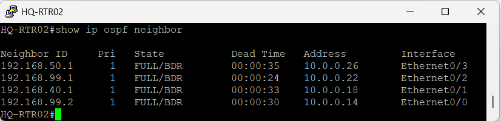

---

## Verification 2 – OSPFv2 Interface Costs

OSPFv2 interface costs were verified on HQ-RTR02 to confirm the preferred and alternate routing design.

**Command**

```text
show ip ospf interface brief
```

**Result**

- The required HQ-RTR02 routed interfaces participate in OSPFv2 Area 0.
- OSPF interface costs differentiate preferred and alternate routing paths.
- Lower-cost interfaces support preferred routing paths.
- Higher-cost interfaces remain available as alternate paths.

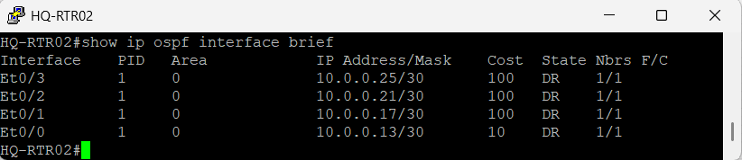

---

## Verification 3 – OSPFv2 Route Learning

The IPv4 routing table on HQ-RTR02 was verified to confirm dynamic route learning across the integrated enterprise network.

**Command**

```text
show ip route ospf
```

**Result**

- Headquarters IPv4 networks are dynamically learned through OSPFv2.
- Branch IPv4 networks are dynamically available through the enterprise routing infrastructure.
- OSPFv2 routes are installed with their associated next-hop addresses, metrics, and forwarding interfaces.
- The routing table confirms HQ-RTR02 participation in the enterprise IPv4 routing domain.

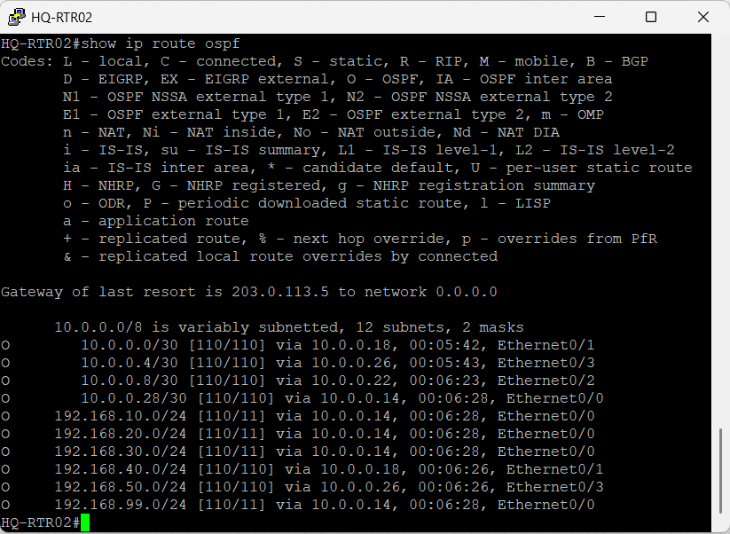

---

## Verification 4 – Branch WAN OSPFv2 Costs

The preferred and backup WAN paths were verified on BR1-RTR01.

**Command**

```text
show ip ospf interface brief
```

**Result**

- The existing WAN connection toward HQ-RTR01 operates with OSPF cost 10.
- The backup WAN connection toward HQ-RTR02 operates with OSPF cost 100.
- Both WAN interfaces participate in OSPFv2.
- The configured interface costs establish the preferred and backup WAN path design.

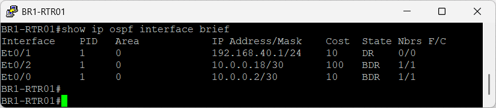

---

## Verification 5 – Preferred IPv4 WAN Path

The normal IPv4 forwarding path from BR1-RTR01 toward Headquarters VLAN 10 was verified.

**Command**

```text
show ip route 192.168.10.0
```

**Result**

- The Headquarters VLAN 10 network is learned through OSPFv2.
- The preferred next hop is `10.0.0.1`.
- The route uses Ethernet0/0 toward HQ-RTR01.
- The installed OSPF route has a metric of 21.

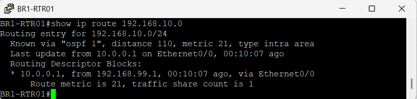

---

## Verification 6 – IPv4 WAN Failover

IPv4 WAN redundancy was tested by temporarily disabling the preferred BR1-RTR01 connection toward HQ-RTR01.

**Verification**

- Preferred BR1 WAN path unavailable
- OSPFv2 route convergence
- Automatic selection of the HQ-RTR02 backup path

**Result**

- The original path through Ethernet0/0 became unavailable.
- OSPFv2 selected the backup WAN path through Ethernet0/2.
- The alternate next hop became `10.0.0.17` through HQ-RTR02.
- The alternate OSPF route was installed with a metric of 111.
- No manual route modification was required during the failover test.
- The preferred connection was restored after verification.

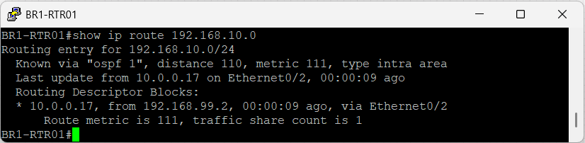

---

## Verification 7 – Secondary Internet Default Route

The IPv4 default route configured on HQ-RTR02 was verified.

**Command**

```text
show ip route 0.0.0.0
```

**Result**

- HQ-RTR02 maintains an IPv4 default route toward ISP-RTR01.
- The default route uses `203.0.113.5` as the next hop.
- The route provides the secondary Headquarters Internet path introduced in Project 11.

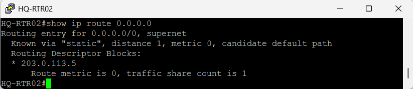

---

## Verification 8 – NAT/PAT Through HQ-RTR02

NAT/PAT operation through HQ-RTR02 was verified using traffic generated by a Branch end device.

The preferred BR1 WAN path was temporarily disabled so that the test traffic was forwarded through the HQ-RTR02 path.

**Command**

```text
show ip nat translations
```

**Result**

- Traffic from BR1 host `192.168.40.21` reached HQ-RTR02.
- The inside local address `192.168.40.21` was translated using the HQ-RTR02 external IPv4 address `203.0.113.6`.
- Multiple ICMP NAT/PAT translation entries were present.
- The captured translations confirm NAT/PAT operation through the secondary Headquarters edge router.
- The preferred WAN connection was restored after verification.

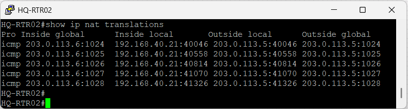

---

## Verification 9 – OSPFv3 Redundant Neighbors

OSPFv3 neighbor relationships were verified on HQ-RTR02.

**Command**

```text
show ipv6 ospf neighbor
```

**Result**

- HQ-RTR02 operates with OSPFv3 Router ID `7.7.7.7`.
- Five OSPFv3 neighbor relationships are present.
- All five neighbors are in the FULL state.
- The captured adjacencies confirm OSPFv3 participation across the redundant Headquarters, Branch WAN, and ISP routing paths.

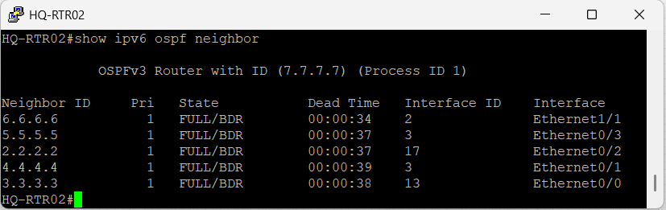

---

## Verification 10 – OSPFv3 Interface Costs

OSPFv3 interface costs were verified on HQ-RTR02.

**Command**

```text
show ipv6 ospf interface brief
```

**Result**

- The required IPv6 routed links participate in OSPFv3 Area 0.
- Interface costs differentiate preferred and alternate IPv6 routing paths.
- Lower-cost interfaces support preferred forwarding paths.
- Higher-cost interfaces remain available as alternate IPv6 paths.

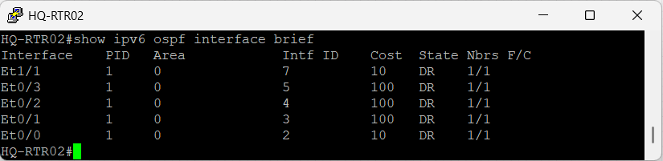

---

## Verification 11 – OSPFv3 Route Learning

The IPv6 routing table on HQ-RTR02 was verified.

**Command**

```text
show ipv6 route ospf
```

**Result**

- Headquarters IPv6 prefixes are dynamically learned through OSPFv3.
- Branch IPv6 networks are available through OSPFv3.
- The learned IPv6 routes include link-local next hops and forwarding interfaces.
- The routing table confirms HQ-RTR02 participation in the enterprise IPv6 routing domain.

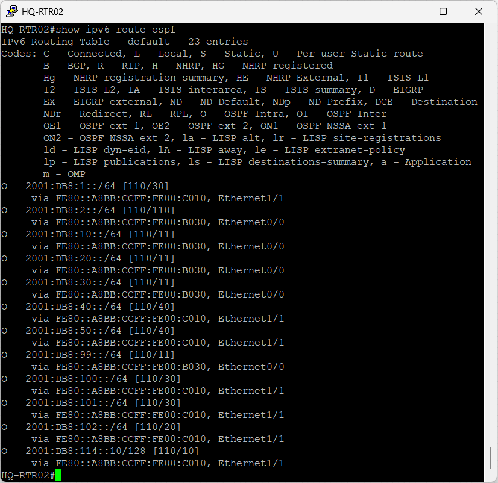

---

## Verification 12 – IPv6 WAN Failover

IPv6 WAN redundancy was tested by temporarily disabling the preferred BR1-RTR01 WAN connection.

**Verification**

- Preferred IPv6 WAN path unavailable
- OSPFv3 route convergence
- Automatic selection of the secondary WAN path

**Result**

- Before the failover test, `2001:DB8:10::/64` was reached through Ethernet0/0 with an OSPF metric of 21.
- After the preferred connection was disabled, OSPFv3 selected Ethernet0/2.
- The alternate IPv6 route was installed with an OSPF metric of 111.
- The routing table confirmed convergence onto the HQ-RTR02 backup path.
- The preferred WAN connection was restored after verification.

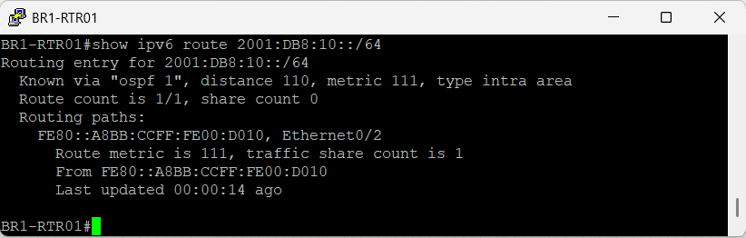

---

## Verification 13 – IPv6 Transit Interfaces

The additional IPv6 transit interfaces introduced on HQ-RTR02 were verified.

**Command**

```text
show ipv6 interface brief
```

**Result**

The following Project 11 IPv6 transit addresses were confirmed on HQ-RTR02:

- Ethernet0/0 – `2001:DB8:3::1`
- Ethernet0/1 – `2001:DB8:103::1`
- Ethernet0/2 – `2001:DB8:4::1`
- Ethernet0/3 – `2001:DB8:104::1`
- Ethernet1/1 – `2001:DB8:105::1`

All five listed transit interfaces were in the `up/up` state in the captured verification output.

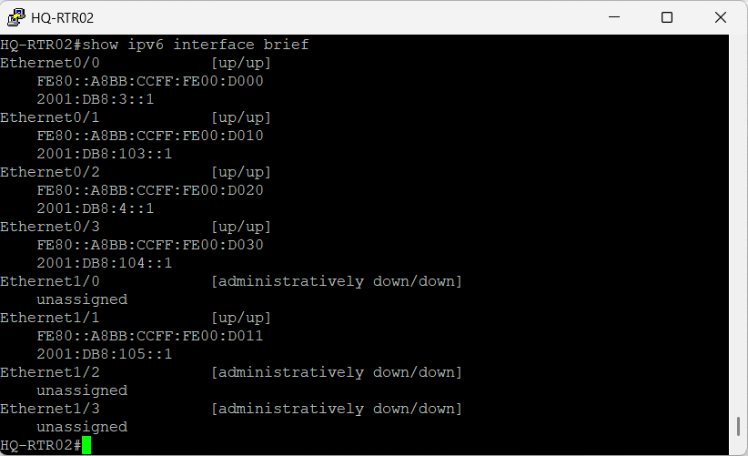

---

## Verification 14 – Linux Management Workstation

SSH-based administrative access was verified from the dedicated Linux management workstation introduced in Project 11.

**Verification**

- Management VLAN IPv4 connectivity
- SSH administrative access to HQ-MLS01
- Remote device verification

**Result**

- `linux-mgmt01` successfully established an SSH session to HQ-MLS01 at `192.168.99.1`.
- Administrative authentication completed successfully.
- HQ-MLS01 was remotely accessed through the Management VLAN.
- The captured HQ-MLS01 output shows VLAN 99 with IPv4 address `192.168.99.1` and an up/up interface state.
- The test confirms SSH-based administrative access from the dedicated Linux management workstation.

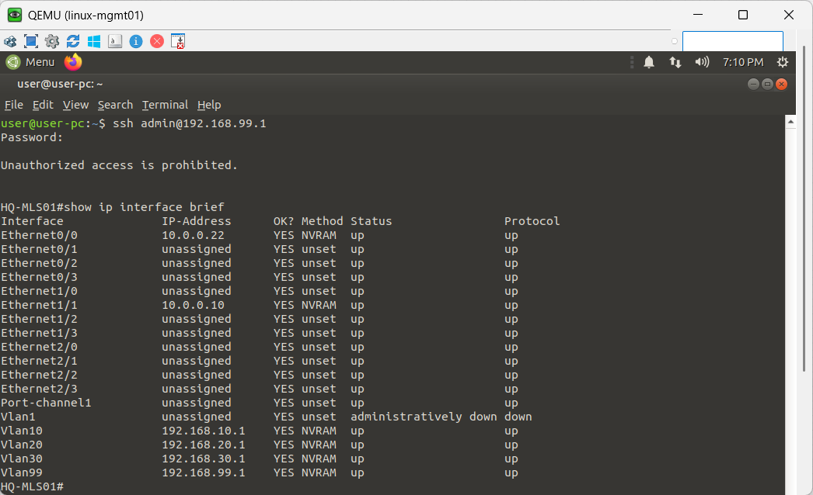

---

## Verification 15 – End-to-End IPv6 Connectivity

End-to-end IPv6 connectivity was verified from HR-PC01 to the external IPv6 destination used for validation.

**Verification**

- IPv6 connectivity from HR-PC01
- Enterprise IPv6 routing
- External IPv6 reachability

**Result**

- HR-PC01 successfully reached `2001:DB8:114::10`.
- ICMPv6 replies were received from the destination.
- The successful test confirms end-to-end IPv6 reachability across the integrated routing infrastructure.

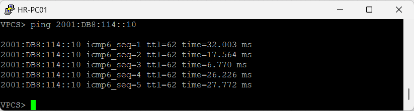

---

## Verification 16 – End-to-End IPv4 Connectivity

IPv4 connectivity was verified from HR-PC01 to the ISP-facing IPv4 destination used for validation.

**Verification**

- IPv4 connectivity from HR-PC01
- Enterprise IPv4 routing
- External-path reachability

**Result**

- HR-PC01 successfully reached `203.0.113.2`.
- ICMP replies were received from the destination.
- The successful test confirms IPv4 reachability through the integrated enterprise routing infrastructure to the verified ISP-facing destination.

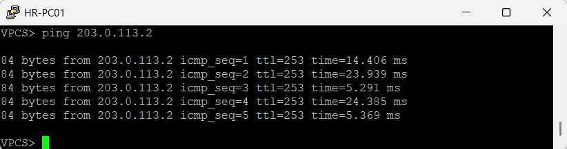

---

## Verification 17 – Headquarters Layer 3 Path Failover

Redundant Layer 3 routing at Headquarters was tested by temporarily disabling the preferred routed connection from HQ-MLS01.

**Verification**

- Preferred Headquarters Layer 3 path unavailable
- OSPFv2 route convergence
- Automatic selection of the alternate Headquarters edge-router path

**Result**

- Before the failover test, HQ-MLS01 reached the BR1 network through next hop `10.0.0.9` on Ethernet1/1 with an OSPF metric of 30.
- After the preferred connection was disabled, OSPFv2 selected next hop `10.0.0.21` through Ethernet0/0.
- The alternate route was installed with an OSPF metric of 210.
- The routing table confirmed use of the redundant Layer 3 path through HQ-RTR02.
- The preferred connection was restored after verification.

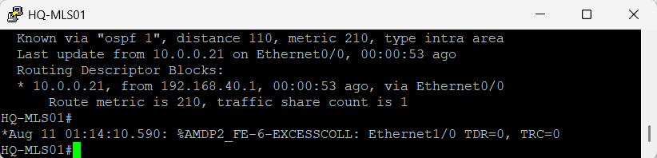

---

## Verification Summary

Project 11 verification confirmed the integration of the additional redundant routing infrastructure introduced in the final NorthStar Enterprise Network design.

HQ-RTR02 was verified as a participant in both the OSPFv2 and OSPFv3 routing domains. The captured evidence confirms the additional Headquarters Layer 3 paths, Branch WAN routing, secondary IPv4 Internet path, NAT/PAT operation through HQ-RTR02, and additional IPv6 transit infrastructure.

Controlled failover testing demonstrated OSPFv2 convergence from the preferred BR1 WAN path to the HQ-RTR02 backup path, OSPFv3 convergence across the corresponding IPv6 WAN paths, and OSPFv2 convergence across the redundant Headquarters Layer 3 infrastructure.

End-to-end IPv6 reachability and IPv4 reachability to the verified ISP-facing destination were successfully demonstrated.

The dedicated `linux-mgmt01` workstation successfully established SSH-based administrative access to HQ-MLS01 through the Management VLAN.

Previously implemented enterprise technologies were preserved as part of the cumulative architecture and were not individually re-verified in Project 11.