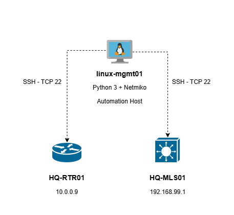

## Design Overview

Project 12 uses the existing NorthStar Enterprise Network infrastructure to implement basic network automation using Python and Netmiko.

The `linux-mgmt01` host serves as the centralized automation workstation, establishing SSH connections to selected Cisco network devices for operational verification and command execution.

---

## Network Components

- **Automation Host:** linux-mgmt01
- **Network Platform:** EVE-NG
- **Programming Language:** Python 3
- **Automation Library:** Netmiko
- **Management Protocol:** SSH (TCP 22)
- **Target Devices:** HQ-MLS01 and HQ-RTR01
---
## Network Automation Topology

The topology illustrates logical SSH management connections between the Linux automation host and the selected enterprise devices.

- **linux-mgmt01:** Centralized Python and Netmiko automation host.
- **HQ-MLS01:** 192.168.99.1
- **HQ-RTR01:** 10.0.0.9

The dashed connections represent SSH automation sessions rather than physical network links.

---

## Automation Workflow

1. Execute the Python automation script from `linux-mgmt01`.
2. Establish SSH connections to the target devices using Netmiko.
3. Execute Cisco IOS operational verification commands.
4. Retrieve and display command outputs.
5. Handle SSH connection and command execution errors.
6. Close SSH sessions after completing automation tasks.
---
## Design Considerations

- Reuse the existing enterprise network infrastructure and management connectivity.
- Limit automation to two network devices.
- Use non-disruptive Cisco IOS verification commands.
- Protect SSH credentials using `getpass`.
- Implement basic error handling using `try/except/finally`.
- Preserve existing network configurations and enterprise services.